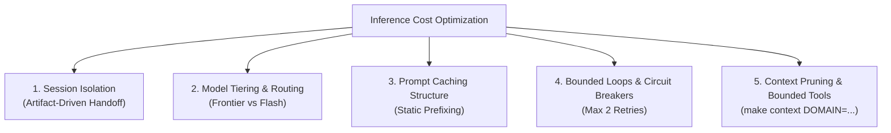

# AI Agent Cost Optimization Playbook (.ai/cost-optimization.md)

> **PURPOSE:** Deliver enterprise-grade software development while minimizing LLM inference costs and token consumption. Aligned with GitHub Copilot guidelines, Snowflake AI Engineering, Toward Next AI, and open-source practices from *Superpowers*, *Matt Pocock Skills*, *ECC*, and *Addy Osmani Agent Skills*.

---

## 1. The 5 Core Levers of Cost Optimization



---

## 2. Lever 1: Phase Session Isolation (Context Window Budgeting)

### The Anti-Pattern: Monolithic Sessions ($O(N^2)$ Token Bloat)
Carrying the entire conversation history from Product Discovery through Technical Architecture, Code Implementation, Testing, and PR Review in a single thread accumulates 100k+ input tokens on every turn. This creates runaway costs.

### The Solution: Artifact-Driven Session Hand-offs
Treat chat context like an ephemeral working memory budget:
1. **Isolated Sessions per Skill:** Each SDLC phase runs in a dedicated, fresh agent session or subagent.
2. **State Anchored in Files:** The output of each phase is committed to disk (`docs/epics/`, `docs/specs/`, `docs/plans/`).
3. **Clean Restart:** The next phase starts with a clean context window, loading ONLY the specific artifact it needs:
   - Skill 01 $\rightarrow$ generates `docs/epics/EPIC-*.md` $\rightarrow$ **Close Session**.
   - Skill 02 $\rightarrow$ opens fresh session, loads ONLY `docs/epics/EPIC-*.md` $\rightarrow$ generates `docs/specs/SPEC-*.md` $\rightarrow$ **Close Session**.
   - Skill 03 $\rightarrow$ opens fresh session, loads ONLY the approved spec and plan $\rightarrow$ implements code.
4. **Targeted Context:** Never dump the entire monorepo into the prompt. Use domain-scoped context packing:
   ```bash
   make context DOMAIN=packages/auth
   ```

---

## 3. Lever 2: Model Tiering & Dynamic Routing

Never use expensive frontier reasoning models for routine execution tasks that smaller, faster models handle equally well.

| SDLC Phase & Role | Recommended Model Tier | Rationale |
| :--- | :--- | :--- |
| **01. Business Discovery** (Product Manager) | **Frontier / Deep Reasoning** (Claude 3.7 Sonnet, Gemini Pro, GPT-4o) | High-ambiguity Socratic reasoning, edge case discovery, MVP scope reduction. |
| **02. Technical Design** (Staff Architect) | **Frontier / Deep Reasoning** (Claude 3.7 Sonnet, Gemini Pro, GPT-4o) | Complex trade-offs, security threat modeling, failure modes, data modeling. |
| **03. Safe Execution** (Senior Engineer) | **Cost-Effective / Fast** (Gemini Flash, Claude Haiku, GPT-4o-mini) | Concrete implementation guided by strict specs; TDD red-green cycle. |
| **04. Test Validation** (QA Lead) | **Cost-Effective / Fast** (Gemini Flash, Claude Haiku, GPT-4o-mini) | Boilerplate test generation, running assertions against spec contracts. |
| **05. Code Review & Governance** (Gatekeeper) | **Frontier / High Precision** (Claude 3.7 Sonnet, Gemini Pro, GPT-4o) | Dual alignment audit, security vulnerability detection, AST boundary checks. |
| **06. Maintenance & RCA** (SRE) | **Tiered:** Flash for triage; Frontier for 5-Whys RCA | Log extraction via Flash; root cause diagnosis via Frontier. |
| **07. Continuous Evaluator** (Quality Arch) | **Cost-Effective / Fast** (Gemini Flash, Claude Haiku, GPT-4o-mini) | Static code smell detection, pattern matching against standards. |
| **Background Subagents** (Explorer, Docs) | **Cost-Effective / Fast** (Gemini Flash, Claude Haiku) | File grepping, documentation lookups, AST inspection. |

---

## 4. Lever 3: Prompt Caching Maximization

Modern LLM providers (Anthropic, Google Gemini, OpenAI) offer **80% to 90% cost discounts** on cached prompt prefixes.

### Best Practices:
1. **Static Top-of-Context:** Keep `AGENTS.md`, `.ai/skills/00-architecture-standards.md`, and skill instructions immutable and positioned at the very beginning of prompts.
2. **Append Dynamic Context at the End:** Place user prompts, diffs, and ticket-specific content at the bottom of the prompt to avoid invalidating the cache prefix.
3. **Long-Running Server Cache:** When using MCP servers, maintain persistent connections rather than reinitializing state on every tool call.

---

## 5. Lever 4: Bounded Loops & Anti-Flailing Circuit Breakers

Inspired by *Jesse Vincent's Superpowers* and Cognizant's *Bounded Repair Loop*:

> [!WARNING]
> **Anti-Flailing Rule:** When an agent attempts to fix a test failure or build error, it is permitted a **MAXIMUM OF 2 AUTOMATED ATTEMPTS**.
> If the test still fails after the second attempt, the agent **MUST HALT IMMEDIATELY**.
> It is strictly forbidden to loop continuously or generate speculative random edits.
> The agent must record its hypothesis, roll back uncommitted changes, and request human intervention.

---

## 6. Lever 5: Bounded Tool Outputs & Token Hygiene

1. **Noisy Command Truncation:**
   Never pipe unlimited terminal output into the agent context.
   ```bash
   # Good: capture summary or last failure lines
   make test 2>&1 | tail -n 50
   
   # Bad: dumping 10,000 lines of build logs into context
   make test
   ```
2. **File Range Inspection:**
   When inspecting large source files (>300 lines), read targeted line ranges rather than entire files.
3. **Session Compaction:**
   When an active execution session exceeds 20 turns, run the `/compact` command to summarize trajectory before proceeding.
