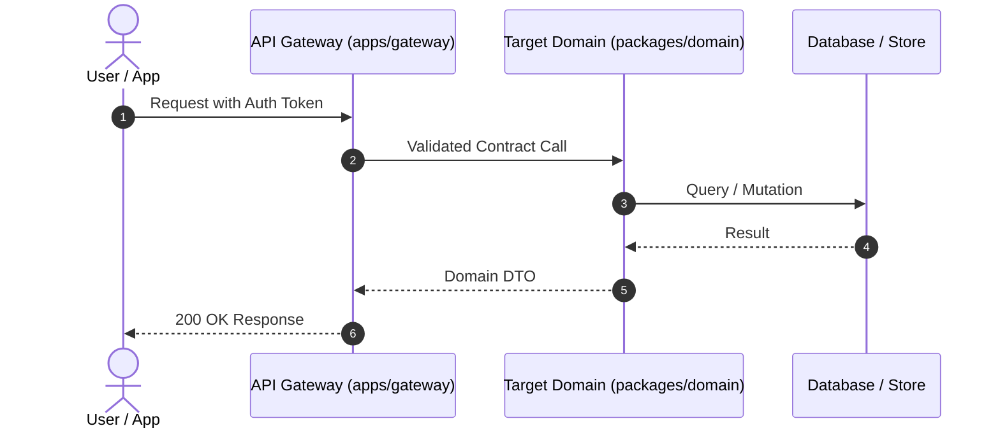

# System Design Spec: [Domain/Service Name]

> **TRACEABILITY REQUIREMENT:** Every component, schema, and API route in this document must trace directly back to an approved requirement in `docs/epics/[epic_id].md`. Over-engineering without epic backing is forbidden.

## 1. Architectural Responsibility & Boundaries

- **Single Responsibility:** [What is the exact boundary of this service/package? What data does it own exclusively?]
- **Monorepo Placement:** [Why does this code belong in `packages/[name]` (shared domain logic) vs `apps/[name]` (deployable application)?]
- **Relevant ADRs:** [List any applicable ADRs from `docs/adr/`]

## 2. Component & Interaction Architecture



## 3. Data Contracts & Interfaces

Define all public interfaces, schemas, and DTOs using strongly typed language blocks or schemas.

```typescript
// Public Contract / Interface definition
export interface DomainEntity {
  id: string;
  createdAt: Date;
  updatedAt: Date;
}
```

## 4. Failure Modes & Resilience (Architecture Grilling)

| Failure Scenario | Impact | Mitigation Strategy |
| :--- | :--- | :--- |
| **Downstream Outage** | Cannot persist state | Exponential backoff retry with circuit breaker |
| **High Concurrency** | Race condition / duplicate write | Optimistic concurrency control / unique DB constraints |
| **Payload Injection** | Invalid or malicious payload | Strict schema validation before domain entry |

## 5. Security & Threat Modeling

- **Authentication & Authorization:** [How is identity established and verified?]
- **Data Protection:** [How is sensitive data encrypted at rest and in transit?]
- **Network & Perimeter:** [Is this service exposed publicly or internal to the monorepo VPC?]

## 6. Upstream & Downstream Dependencies

- **Upstream (Consumes from):** [List external APIs or other monorepo packages]
- **Downstream (Consumed by):** [List apps or packages that import this contract]

## 7. Domain-Specific Invariants & Business Rules

*Hard technical rules unique to this domain that code generation must strictly enforce.*

- **Rule 1:** [e.g., "All monetary calculations must use BigInt to avoid float precision issues"]
- **Rule 2:** [e.g., "State transitions must follow an explicit finite state machine with immutable audit logs"]

## 8. Technical Sign-Off Gate

_Transitioning status from `tech_grilling` to `tech_approved` requires explicit human review._

- [ ] Reviewed and approved by Lead Architect: @[lead]
- Architecture Review Notes: [Optional remarks]
