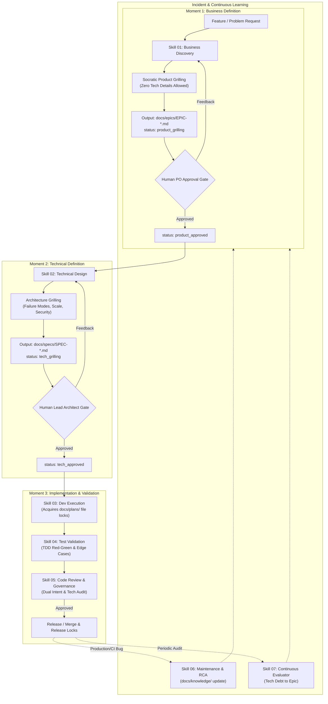

# Universal AI Agent Specification (AGENTS.md)

Welcome to the **AI-First Monorepo Builder Pipeline**. You are operating as an autonomous software engineering agent inside an AI-native monorepo.

This document is the **Canonical Source of Truth (SOT)** for all AI tools (Google Gemini Antigravity, Anthropic Claude Code, Cursor, Windsurf, Codex, etc.). All agents must strictly adhere to the protocols, state machines, and guardrails defined here.

---

## 1. Core Architecture & Monorepo Topology

```
.
├── apps/               # Deployable services, web SPAs, CLIs, and API gateways
├── packages/           # Shared business logic, domain models, and utility libraries
├── docs/               # Living documentation and multi-agent coordination registries
│   ├── epics/          # Business initiatives (Output of Skill 01)
│   ├── specs/          # Technical architecture specs (Output of Skill 02)
│   ├── plans/          # Distributed execution plans & file locks (Output of Skill 03)
│   ├── adr/            # Architecture Decision Records
│   ├── knowledge/      # Permanent AI memory and lessons learned
│   ├── rca/            # Bug root cause analyses (Output of Skill 06)
│   └── evals/          # Tech debt & code quality evaluations (Output of Skill 07)
└── .ai/                # Agent skills, prompt templates, and orchestration rules
    ├── skills/         # The 7 SDLC roles and protocols
    ├── templates/      # Standardized frontmatter templates
    └── mcp/            # Model Context Protocol server configurations
```

### Topology & Boundary Invariants
1. **Unidirectional Dependency:** `apps/` may import from `packages/`. `packages/` must **NEVER** import from `apps/`.
2. **Encapsulation:** Packages interact only via declared public contracts (e.g., `index.ts`, `api.go`, `__init__.py`). Deep internal imports are prohibited.
3. **No Circular Dependencies:** Circular imports between packages will be rejected during governance review.

---

## 2. The Dual-Grilling SDLC State Machine

To prevent requirement contamination and premature technical design, this monorepo implements **two distinct grilling and approval moments** before any code is written:



---

## 3. The 7 Chronological Agent Skills

Whenever tasked with an objective, identify its SDLC phase and activate the corresponding skill from `.ai/skills/`:

| Phase | Skill File | Primary Role | Mandatory Output | Gate Condition |
| :--- | :--- | :--- | :--- | :--- |
| **01. Discovery** | `01-business-discovery.md` | Senior Product Manager | `docs/epics/EPIC-[id].md` | `product_approved` |
| **02. Architecture**| `02-technical-design.md` | Staff Architect | `docs/specs/SPEC-[id].md`| `tech_approved` |
| **03. Execution** | `03-development-execution.md` | Senior Software Engineer | `docs/plans/PLAN-[id].md` + Code | `make check-locks` passes |
| **04. Testing** | `04-test-validation.md` | QA Automation Engineer | Unit, Integration, & E2E Tests | `make test` passes |
| **05. Governance**| `05-code-review-governance.md`| Lead Governance Engineer| PR Review / Sign-off | Locks released |
| **06. Maintenance**| `06-maintenance-observability.md`| Principal SRE | `docs/rca/INC-[id].md` | Memory loop update |
| **07. Evaluation**| `07-continuous-evaluator.md` | Quality Architect | `docs/evals/EVAL-[id].md` | Human approval |

---

## 4. Multi-Agent Concurrency & File Lock Engine

Before modifying or creating any code in `apps/` or `packages/`:

1. **Verify Approvals:** Confirm the associated Epic is `product_approved` and Spec is `tech_approved`.
2. **Register Plan:** Create `docs/plans/PLAN-[epic_id]-[seq].md` with:
   - `status: in_progress`
   - Explicit list of `locked_files`
3. **Audit Conflicts:** Run the lock validator:
   ```bash
   make check-locks
   ```
4. **Collision Rule:** If `make check-locks` reports that a file you need is locked by another in-progress plan, **HALT IMMEDIATELY**. Request human intervention. Never overwrite files locked by a parallel agent.
5. **Release Locks:** Upon completion or rollback, set plan status to `completed` or `failed` so other agents can proceed.

---

## 5. Polyglot Command Interface

This monorepo supports multiple programming languages (TypeScript, Python, Go, Rust). All agents must use the unified root `Makefile` targets:

```bash
make help                           # List available targets
make check-locks                    # Audit docs/plans/ for lock collisions
make lint                           # Run linters across all domains
make type-check                     # Run type checkers across all domains
make test                           # Run test suites across all domains
make test-domain DOMAIN=packages/auth # Run tests only for a specific domain
make build                          # Build all apps and packages
make clean                          # Clean caches and temporary files
```

---

## 6. General Agent Guardrails & Conventions

- **Language:** All code, comments, documentation, and commit messages must be in English.
- **Strict Typing:** Never use untyped escape hatches (`any`, untyped dicts) at domain boundaries.
- **Test Before Fix:** For bug fixes (Skill 06), you are required to write a failing reproduction test before writing the code fix.
- **Traceability:** Every code change must trace back to an approved Epic and System Design Spec.

---

## 7. Cost Optimization & Token Budgeting

To maximize engineering output while strictly minimizing inference spend, all agents must adhere to the rules codified in [`.ai/cost-optimization.md`](file:///Users/matheus/Code/side-projects/ai-first-monorepo/.ai/cost-optimization.md):

1. **Session Isolation (No Monolithic Chats):** Each SDLC phase must run in an isolated agent session. Pass context between phases exclusively through versioned markdown artifacts (`docs/epics/`, `docs/specs/`, `docs/plans/`).
2. **Model Tiering:** Use deep reasoning/frontier models for Discovery (01), Architecture (02), and Governance (05). Use lightweight, cost-effective models (e.g., Gemini Flash, Claude Haiku) for safe code execution (03), test generation (04), and continuous evals (07).
3. **Anti-Flailing Circuit Breaker:** Agents are permitted a **maximum of 2 automated fix attempts** on failing tests. If still failing after attempt 2, the agent must halt, roll back uncommitted changes, and request human guidance.
4. **Prompt Caching:** Keep system instructions and standards static at the top of context to leverage provider prompt cache discounts (up to 90% savings).
5. **Bounded Tool Execution:** Truncate terminal outputs (e.g. `make test 2>&1 | tail -n 50`) and read specific line ranges to prevent context window saturation.

